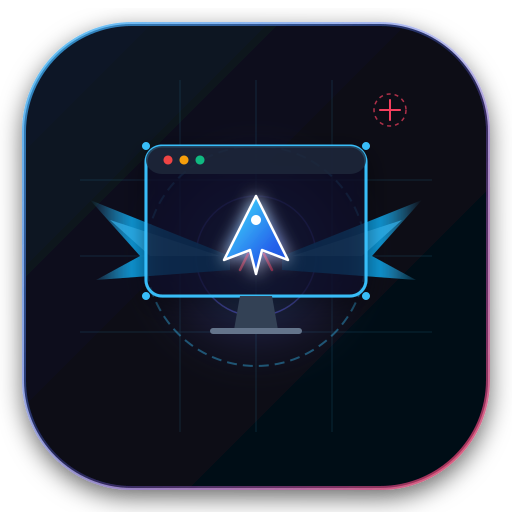
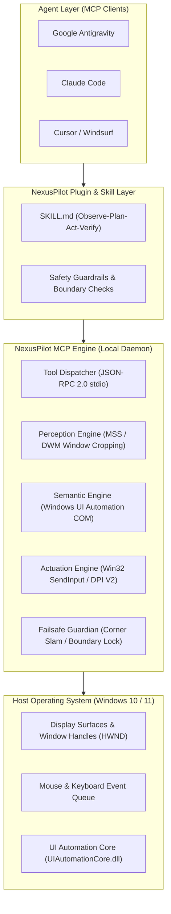

# Project NexusPilot

<p align="center">
  
</p>

<p align="center">
  <strong>Universal Desktop Computer-Use MCP Suite & Antigravity Plugin</strong><br />
  <em>Empower AI agents with human-grade vision, mouse actuation, keyboard input, and Windows UI Automation.</em>
</p>

<p align="center">
  <a href="https://github.com/nishantshaligram/NexusPilot/actions"></a>
  <a href="https://nishantshaligram.github.io/NexusPilot/"></a>
  <a href="LICENSE"></a>
  
  
</p>

---

## Architecture Overview

NexusPilot bridges the gap between text-native coding agents and native Windows software (IDEs, database clients, Figma Desktop, settings consoles) using **Dual-Modal Perception** and **Win32 `SendInput` Kinematics**:



---

## Key Features

1. **Dual-Modal Perception**:
   - **Semantic Stream**: Interfaces with `UIAutomationCore.dll` via typed COM to extract interactive controls (Buttons, Text boxes, Menus) with exact pixel bounding boxes.
   - **Visual Stream**: Sub-30ms hardware screen capture with DWM extended frame bounds (eliminating invisible 7px drop shadow margins) and targeted window cropping.
2. **Per-Monitor DPI v2 Normalized Actuation**:
   - Dispatches mouse and keyboard events using native Win32 `SendInput`.
   - Immune to multi-monitor coordinate drift across 100%, 125%, 150%, and 200% display scaling.
3. **Safety Guardian & Failsafes**:
   - **Hardware Corner Failsafe**: Slamming the physical mouse cursor into `(0, 0)` immediately halts all automation.
   - **Application Boundary Isolation**: Restricts clicks strictly to authorized target window rectangles.
   - **Destructive Action Gates**: Detects high-risk operations (e.g. `format`, `drop table`, `rm -rf`) and triggers human confirmation.
4. **Universal Agent Compatibility**:
   - Implements standard Model Context Protocol (MCP).
   - Bundles native plugin integration for **Google Antigravity**, **Claude Code**, **Claude Desktop**, **Cursor**, and **Windsurf**.

---

## 1-Click Quickstart

### 1. Install Dependencies & Configure Agents
Run the universal installer from PowerShell:
```powershell
powershell -ExecutionPolicy Bypass -File nexus-pilot/scripts/install-agents.ps1
```
*(Or double-click `nexus-pilot/install-agents.bat` in Windows Explorer).*

### 2. Verify Your Environment
```powershell
powershell -ExecutionPolicy Bypass -File nexus-pilot/scripts/verify-environment.ps1
```

### 3. Run Automated Tests
```powershell
python nexus-pilot/tests/test_pilot.py
```

---

## MCP Tools Reference

| Tool | Parameters | Description |
|---|---|---|
| `capture_screen` | `monitor_index`, `window_title`, `crop_rect`, `max_dimension` | Captures high-res desktop or window screenshot as base64 PNG with DPI scale. |
| `inspect_ui_tree` | `window_title`, `max_depth`, `interactive_only` | Traverses the Windows UI Automation accessibility tree to return controls with coordinates. |
| `find_element` | `query`, `window_title` | Searches for a specific control by name, label, or automation ID. |
| `click_element` | `query`, `window_title`, `button`, `clicks` | Deterministically clicks a control by semantic name with automatic window focus. |
| `mouse_click` | `x`, `y`, `button`, `clicks` | Sends low-level Win32 `SendInput` mouse clicks. |
| `mouse_drag` | `start_x`, `start_y`, `end_x`, `end_y`, `speed_ms` | Performs mouse drag-and-drop gestures with smoothed trajectory. |
| `mouse_scroll` | `direction`, `amount`, `x`, `y` | Dispatches mouse wheel scroll events. |
| `send_keystrokes` | `text`, `keys`, `delay_ms` | Sends Unicode character typing or keyboard hotkey chords (e.g. `['ctrl', 'shift', 'p']`). |
| `focus_window` | `title_keyword` | Restores and brings window to foreground using Win32 thread input handshake. |
| `get_active_window` | *(none)* | Returns currently focused application window title, HWND, PID, rect, and DPI scale. |
| `set_safety_boundary` | `enabled`, `hwnd` | Locks click actuation exclusively within target window bounding box. |
| `reset_safety_failsafe` | *(none)* | Resets emergency corner abort flag. |
| `check_health` | *(none)* | Verifies screen metrics, cursor position, UIA COM status, and active safety guards. |

---

## Documentation

Full documentation, architecture specifications, and agent guides are available at:
👉 **[https://nishantshaligram.github.io/NexusPilot/](https://nishantshaligram.github.io/NexusPilot/)**

---

## License

This project is licensed under the [Apache License, Version 2.0](LICENSE).
