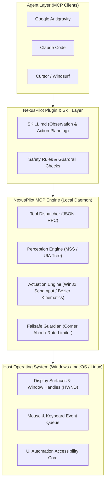
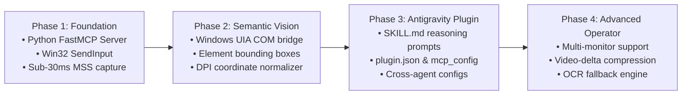

# Project NexusPilot: Universal Desktop Computer-Use Plugin & MCP Suite
## Ideation, Architectural Blueprint & Implementation Specification

> **Version:** 1.0.0-PROPOSAL • **Status:** Approved for Ideation • **Target Ecosystem:** Antigravity, Claude Code, Cursor, Windsurf

---

## 1. Executive Summary & Core Thesis

Modern AI coding agents excel at manipulating text, executing CLI commands, and reading local file trees. However, they hit a hard boundary when interacting with **native desktop software**—such as IDEs (Visual Studio, Xcode), database thick clients (DBeaver, TablePlus), design tools (Figma Desktop), local emulators, enterprise ERPs, and Windows management consoles.

**Project NexusPilot** is an open, modular **Desktop Human-Grade Automation Suite** delivered as a cross-compatible **Model Context Protocol (MCP) Server** and an **Antigravity Plugin + Skill**. It provides AI agents with human-like vision, mouse control, keyboard input, and OS accessibility perception, allowing them to operate any desktop software without requiring custom API integration.



---

## 2. Key Limitations Solved

| Traditional Approach | Key Limitation | NexusPilot Solution |
|---|---|---|
| **API-Only Integration** | Most desktop apps lack comprehensive local REST/RPC APIs. | Universal surface interaction via mouse, keyboard, and visual perception. |
| **Pure Pixel Guessing (Vision LLM)** | High hallucination rate, breaks on Windows DPI scaling (125%/150%), misses small icons. | **Dual-Modal Perception**: Combines high-resolution screenshots with the **Windows UI Automation (UIA) accessibility tree** for 100% coordinate precision. |
| **Vendor Lock-in** | Proprietary "Computer Use" implementations locked into single vendor cloud containers. | Runs 100% locally on developer workstations over the open **Model Context Protocol (MCP)**. |
| **Unsafe Automation** | Rogue clicks, accidental closing of unsaved files, or loss of user control. | Hardware failsafe: Corner slamming, human override hotkeys, and bounded application focus locking. |

---

## 3. System Architecture & Core Modules

### 3.1 Dual-Modal Perception Engine
Rather than relying solely on raw vision (which is computationally expensive and coordinate-fragile), NexusPilot implements a dual-stream perception pipeline:

1. **Visual Stream (Screen Capture)**:
   - Uses sub-30ms capture libraries (`mss` or Windows DXGI Desktop Duplication API).
   - Handles multi-monitor setups, DPI scaling factors, and specific window-bounding boxes.
   - Compresses captures with smart region-of-interest cropping to reduce LLM token overhead.
2. **Semantic Stream (Windows UI Automation / Accessibility)**:
   - Queries `UIAutomationCore.dll` to inspect native controls (buttons, menus, text inputs, combo boxes).
   - Extracts exact bounding boxes: `{ "type": "Button", "label": "Save Changes", "rect": [420, 680, 120, 36] }`.
   - Allows the agent to click targeted controls by semantic name rather than blind pixel estimation.

### 3.2 Human-Grade Actuation Engine
Native OS events are generated using low-level Win32 `SendInput` hooks:
- **Mouse Dynamics**:
  - `click(x, y, button='left'|'right'|'middle', count=1|2)`
  - `drag_and_drop(from_x, from_y, to_x, to_y, duration_ms)`
  - `scroll(direction='up'|'down', amount, x, y)`
  - Optional smoothed Bézier curve trajectories to prevent triggering anti-bot or rapid-jitter UI bugs.
- **Keyboard Dynamics**:
  - `type_text(string, wpm_delay)` with full Unicode character code support.
  - `hotkey(combo)`: Handles complex modifier chords (e.g. `Ctrl+Shift+P`, `Alt+F4`, `Win+R`).
- **Window Management**:
  - `focus_window(title_or_pid)`: Brings target software to foreground prior to action execution.
  - `get_active_window()`: Verifies the correct application is receiving inputs.

### 3.3 The Self-Correcting Verification Loop
Every agent action executes under an **Observe → Plan → Act → Verify** cycle:
1. **Pre-Action Snapshot**: Capture state $S_0$ and focused window.
2. **Execution**: Fire atomic action (e.g., Click Button `0x004F`).
3. **Post-Action Snapshot**: Capture state $S_1$ after a calibrated UI settling delay (50–150ms).
4. **Delta Verification**: If the expected UI change did not occur (e.g., dialog remains open), the agent receives immediate feedback to recalibrate or escalate.

---

## 4. MCP Tool Specification (The Universal Interface)

The MCP server exposes the following standardized tools across stdio/SSE:

```typescript
// MCP Tool Definitions
interface DesktopPilotTools {
  // Perception
  capture_screen: {
    args: { monitor_index?: number; window_title?: string; crop_rect?: [number, number, number, number] };
    returns: { image_base64: string; width: number; height: number; dpi_scale: number };
  };

  inspect_ui_tree: {
    args: { window_title?: string; max_depth?: number };
    returns: { elements: Array<{ id: string; name: string; control_type: string; rect: number[] }> };
  };

  // Actuation
  mouse_click: {
    args: { x: number; y: number; button?: 'left' | 'right' | 'middle'; clicks?: number };
    returns: { success: boolean; cursor_position: [number, number] };
  };

  mouse_drag: {
    args: { start_x: number; start_y: number; end_x: number; end_y: number; speed_ms?: number };
    returns: { success: boolean };
  };

  send_keystrokes: {
    args: { text?: string; keys?: string[]; delay_ms?: number };
    returns: { success: boolean };
  };

  focus_window: {
    args: { title_keyword: string };
    returns: { success: boolean; window_title: string; hwnd: number };
  };
}
```

---

## 5. Antigravity Plugin & Skill Bundle Structure

When authored as an Antigravity plugin, the project is structured as follows:

```text
desktop-pilot/
├── plugin.json                       # Plugin descriptor, author metadata, permissions
├── mcp_config.json                   # Local MCP daemon bootstrap command
├── skills/
│   └── desktop-human-pilot/
│       ├── SKILL.md                  # LLM reasoning strategy, pre-flight checks, error recovery
│       └── references/
│           ├── windows_hotkeys.md    # Standard keyboard shortcut library
│           └── uia_selectors.md      # UI Automation selector patterns
├── rules/
│   └── desktop_safety_guardrails.md  # Restricted areas, emergency stops, confirmation gates
├── server/
│   ├── pilot_server.py               # FastMCP Python server implementation
│   ├── uia_bridge.py                 # Windows UIAutomation COM interop
│   ├── input_synthesizer.py          # Win32 SendInput / mouse kinematics
│   └── requirements.txt              # pyautogui, mss, pywinauto, mcp[cli]
└── scripts/
    ├── install-service.ps1           # Windows local service installer
    └── verify-environment.ps1        # DPI and accessibility permission probe
```

---

## 6. Safety Guardrails & Human-in-the-Loop Safeguards

1. **Hardware Corner Failsafe**: Slamming the physical mouse into any corner (e.g. `(0, 0)`) immediately pauses all agent automation and releases OS hooks.
2. **Panic Key Interrupt**: `Ctrl + Alt + Escape` immediately kills the active MCP tool process.
3. **Application Boundary Guard**: Restricts mouse clicks exclusively within the bounding rectangle of the authorized application window (prevents clicking outside into personal messaging apps, browser tabs, or system trays).
4. **High-Risk Confirmation Gates**: Any action targeting irreversible buttons (`Format`, `Delete Database`, `Authorize Payment`, `Commit to Production`) prompts the user for explicit Human-in-the-Loop (HITL) approval.

---

## 7. Phased Implementation Roadmap



- **Phase 1 (MVP)**: Basic screenshot and coordinate-based mouse/keyboard MCP server.
- **Phase 2 (Reliability)**: Windows UI Automation tree parser for deterministic, resolution-independent button clicking.
- **Phase 3 (Packaging)**: Bundling into an installable Antigravity plugin and publishing MCP setup guides for Claude Code and Cursor.
- **Phase 4 (Enterprise)**: Multi-monitor workspace awareness, optical character recognition (OCR) fallbacks for custom canvas controls, and macro recording.
