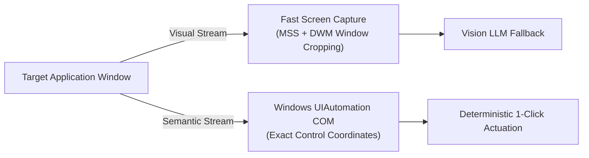

# Dual-Modal Perception Architecture

Traditional vision-only computer-use agents rely solely on raw screenshots. This approach leads to high coordinate hallucination, breaks under Windows DPI scaling (125%/150%), and incurs large token overhead.

NexusPilot solves this by implementing a **dual-modal perception stream**:

---

## 1. The Semantic Stream (Windows UI Automation)

NexusPilot interfaces with Windows `UIAutomationCore.dll` via typed COM client wrappers:

- **Exact Bounding Boxes**: Extracts `[x, y, width, height]` and center points directly from the operating system accessibility tree.
- **Zero Coordinate Guessing**: The agent clicks `click_element(query="Save")` rather than estimating pixels.
- **Token Efficiency**: A semantic tree representation costs ~300 to 500 tokens, saving 70%+ compared to streaming full-screen images.

---

## 2. The Visual Stream (Screen Capture Engine)

When an application renders on a custom canvas (DirectX, Electron canvas, game engines) where semantic accessibility nodes are absent, the visual stream takes over:

- **Sub-30ms Capture**: Uses `mss` for high-throughput screen grabs.
- **DWM Extended Frame Bounds**: Queries `DwmGetWindowAttribute` with `DWMWA_EXTENDED_FRAME_BOUNDS` (flag 9) to eliminate the invisible 7-pixel drop shadow padding found in standard Win32 `GetWindowRect`.
- **Targeted Window Cropping**: Crops directly to the active application window bounding box, preserving privacy and reducing tokens.
