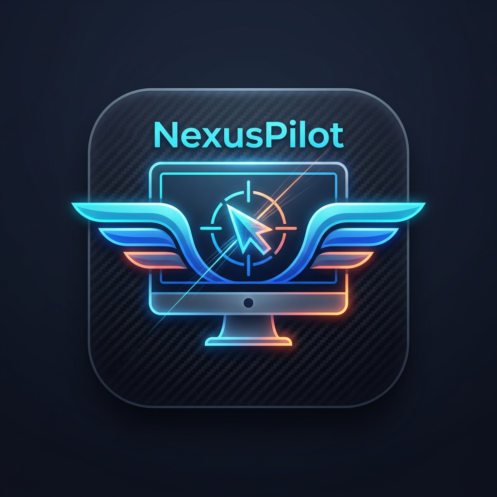
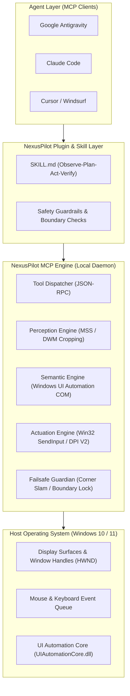

# Project NexusPilot

  

**NexusPilot** is an open-source, modular **Desktop Human-Grade Automation Suite** delivered as a cross-compatible **Model Context Protocol (MCP) Server** and an **Antigravity Plugin + Skill**.

It provides AI agents with human-like vision, mouse control, keyboard input, and native Windows accessibility perception, enabling autonomous operation of native desktop software.

---

## Frequently Asked Questions

### What is NexusPilot?
NexusPilot is an open-source Desktop Computer-Use automation suite delivered as a Model Context Protocol (MCP) server and Google Antigravity plugin. It enables AI coding agents to control native Windows desktop applications using mouse actuation, keyboard typing, and accessibility perception.

### How does NexusPilot compare to Anthropic Computer Use?
Anthropic Computer Use runs inside isolated cloud Docker containers with pure vision models. NexusPilot runs **100% locally on your Windows developer workstation** and uses **Dual-Modal Perception**: it combines screen capture with the Windows UI Automation (UIA) accessibility tree to achieve 100% click precision without coordinate guessing.

### Which AI coding agents work with NexusPilot?
NexusPilot adheres to the open Model Context Protocol (MCP) standard and is verified to work out-of-the-box with **Google Antigravity**, **Claude Code CLI**, **Claude Desktop**, **Cursor IDE**, and **Windsurf**.

### How does the emergency stop failsafe work?
If an automated agent ever exhibits unexpected behavior, slam the physical mouse cursor into the top-left corner `(0, 0)`. The hardware failsafe immediately pauses all synthetic input and aborts the task.

---

## Key Highlights

- **Dual-Modal Perception**: Combines sub-30ms screen capture with the Windows UI Automation (UIA) accessibility tree for 100% coordinate precision.
- **DPI-Aware Win32 Actuation**: Low-level `SendInput` mouse and keyboard control with Per-Monitor DPI v2 normalization.
- **Hardware Corner Failsafe**: Slamming the physical mouse cursor to `(0, 0)` immediately halts all automation.
- **Cross-Agent Compatible**: Works out-of-the-box with Google Antigravity, Claude Code, Claude Desktop, Cursor, and Windsurf via standard MCP.
