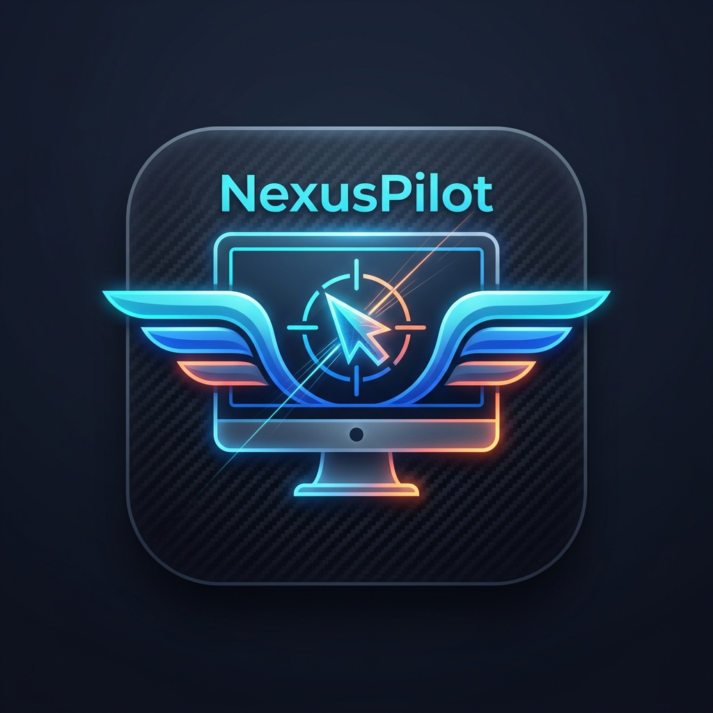
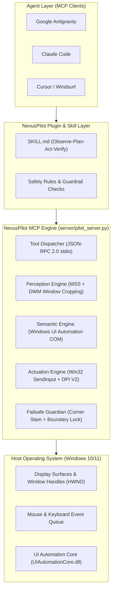

# Project NexusPilot: Universal Desktop Computer-Use MCP Suite

<p align="center">
  
</p>

<p align="center">
  <strong>Universal Desktop Computer-Use MCP Suite & Antigravity Plugin</strong>
</p>

**Project NexusPilot** is a production-grade **Desktop Human-Grade Automation Suite** delivered as a cross-compatible **Model Context Protocol (MCP) Server** and an **Antigravity Plugin & Skill**. It equips AI agents with human-like vision, mouse control, keyboard input, and native Windows accessibility perception.

---

## Architecture Overview



---

## Directory Structure

```text
nexus-pilot/
├── plugin.json                       # Antigravity Plugin descriptor
├── mcp_config.json                   # Universal MCP server configuration
├── requirements.txt                  # Python dependencies
├── README.md                         # Project documentation
├── server/
│   ├── pilot_server.py               # MCP Server entrypoint
│   ├── screen_capture.py             # Sub-30ms MSS capture & DWM window cropping
│   ├── uia_bridge.py                 # Windows UI Automation (UIA) COM bridge
│   ├── input_synthesizer.py          # Native Win32 SendInput mouse & keyboard engine
│   └── safety_guard.py               # Hardware corner failsafe & boundary isolation
├── skills/
│   └── desktop-human-pilot/
│       ├── SKILL.md                  # LLM reasoning strategy & Observe-Plan-Act-Verify loop
│       └── references/
│           ├── windows_hotkeys.md    # Standard Windows shortcut library
│           └── uia_selectors.md      # UI Automation control selector reference
├── rules/
│   └── desktop_safety_guardrails.md  # Restricted areas, emergency stops, confirmation gates
├── scripts/
│   ├── install-service.ps1           # Automated dependency installer
│   └── verify-environment.ps1        # DPI, monitor, and COM accessibility diagnostic probe
└── tests/
    └── test_pilot.py                 # Automated unit and integration test suite
```

---

## Quickstart Setup

### 1. Prerequisites
- Windows 10 or 11 (64-bit)
- Python 3.10+ installed

### 2. Install Dependencies
Run the included setup script:
```powershell
powershell -ExecutionPolicy Bypass -File scripts\install-service.ps1
```

Or install manually via pip:
```bash
pip install --user -r requirements.txt
```

### 3. Run Environment Diagnostic
Verify display metrics, DPI scaling, and COM UIAutomation accessibility:
```powershell
powershell -ExecutionPolicy Bypass -File scripts\verify-environment.ps1
```

### 4. Run Automated Tests
```bash
python tests\test_pilot.py
```

---

## Agent Configuration (MCP Integration)

### A. Google Antigravity
NexusPilot includes a ready-to-use `plugin.json`. You can load it directly as a workspace plugin or point your Antigravity MCP settings to `server/pilot_server.py`:
```json
{
  "mcpServers": {
    "nexus-pilot": {
      "command": "python",
      "args": ["F:/Personal/ComputerUse/nexus-pilot/server/pilot_server.py"]
    }
  }
}
```

### B. Claude Code
Add to your Claude Code MCP settings (`~/.claude.json` or project `.mcp.json`):
```json
{
  "mcpServers": {
    "nexus-pilot": {
      "command": "python",
      "args": ["F:/Personal/ComputerUse/nexus-pilot/server/pilot_server.py"]
    }
  }
}
```

### C. Cursor & Windsurf
Add to your Cursor / Windsurf MCP configuration:
```json
{
  "mcpServers": {
    "nexus-pilot": {
      "command": "python",
      "args": ["F:/Personal/ComputerUse/nexus-pilot/server/pilot_server.py"]
    }
  }
}
```

---

## MCP Tools Reference

| Tool | Parameters | Description |
|---|---|---|
| `capture_screen` | `monitor_index`, `window_title`, `crop_rect`, `max_dimension` | Captures high-res desktop or window screenshot as base64 PNG with DPI scale. |
| `inspect_ui_tree` | `window_title`, `max_depth`, `interactive_only` | Traverses the Windows UIAutomation accessibility tree to return controls with coordinates. |
| `find_element` | `query`, `window_title` | Searches for a specific control by name, label, or automation ID. |
| `click_element` | `query`, `window_title`, `button`, `clicks` | Deterministically clicks a control by semantic name with automatic window focus. |
| `mouse_click` | `x`, `y`, `button`, `clicks` | Sends low-level Win32 `SendInput` mouse clicks. |
| `mouse_drag` | `start_x`, `start_y`, `end_x`, `end_y`, `speed_ms` | Performs mouse drag-and-drop gestures with smoothed trajectory. |
| `mouse_scroll` | `direction`, `amount`, `x`, `y` | Dispatches mouse wheel scroll events. |
| `send_keystrokes` | `text`, `keys`, `delay_ms` | Sends Unicode character typing or keyboard hotkey chords (e.g. `['ctrl', 'shift', 'p']`). |
| `focus_window` | `title_keyword` | Restores and brings window to foreground using Win32 thread input handshake. |
| `get_active_window` | *(none)* | Returns currently focused application window title, HWND, PID, rect, and DPI scale. |
| `set_safety_boundary` | `enabled`, `hwnd` | Locks click actuation exclusively within target window bounding box. |
| `reset_safety_failsafe` | *(none)* | Resets emergency corner abort flag. |
| `check_health` | *(none)* | Verifies screen metrics, cursor position, UIA COM status, and active safety guards. |

---

## Safety Features

1. **Hardware Corner Failsafe**: Slamming the physical mouse cursor into the top-left corner `(0, 0)` immediately halts all automation and releases OS hooks.
2. **Application Boundary Guard**: Prevents clicks from escaping into personal messaging apps, browser tabs, or system trays.
3. **High-Risk Confirmation Gates**: Automatically flags destructive actions containing keywords like `format`, `drop database`, or `commit to production`.
