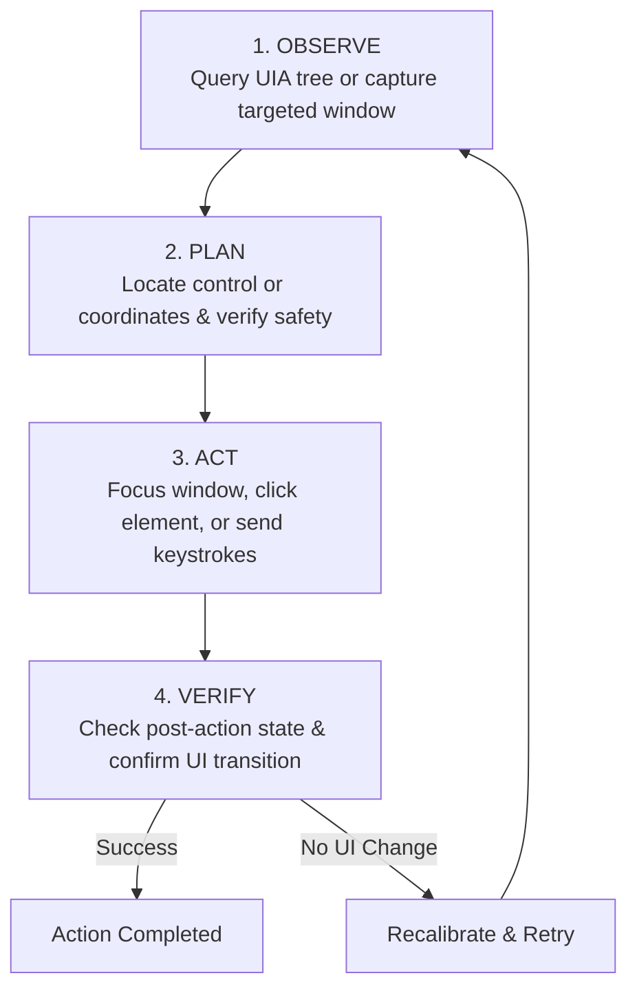

# Desktop Human Pilot Skill

This skill guides agents in operating native Windows desktop applications (Visual Studio, database clients, Figma, ERPs, settings consoles) with human-like precision and safety.

---

## 1. The Core Cognitive Loop: Observe → Plan → Act → Verify

Every interaction with native software must adhere to this 4-step loop. Never execute blind sequences without verification.

### Step 1: Observe (The Dual-Modal Hierarchy)
Always prefer semantic inspection over blind full-screen images:
1. **Semantic First**: Call `inspect_ui_tree(window_title="...")` or `find_element(query="Save")`.
   - Returns deterministic element coordinates `[x, y, width, height]` and `center`.
   - Consumes minimal tokens and is 100% immune to DPI scaling discrepancies.
2. **Visual Fallback**: If the app renders on a custom canvas (DirectX, Electron canvas, game engines) or controls lack UIA labels:
   - Call `capture_screen(window_title="...")`.
   - Prefer passing `window_title` to crop directly to the window, saving 80% of image tokens.

### Step 2: Plan
- Ensure the target window is authorized and belongs to the task.
- Check if the action is destructive (e.g., "Delete", "Drop", "Format"). If destructive, pause and confirm with the user.
- If using coordinates, verify they fall within the application's active window bounds.

### Step 3: Act
- **Deterministic Click**: Use `click_element(query="...", window_title="...")` whenever an element name or ID is known. It automatically handles window focus and center-point clicking.
- **Coordinate Click**: Use `mouse_click(x=..., y=...)` for canvas or custom coordinates.
- **Keyboard & Shortcuts**: Use `send_keystrokes(keys=["ctrl", "s"])` for hotkeys or `send_keystrokes(text="...")` for typing.

### Step 4: Verify
- After acting, allow a brief UI settling pause (100–300ms).
- Check `get_active_window()` or `inspect_ui_tree()` to ensure the dialog closed, button state changed, or new view appeared.
- If no change occurred, retry once with an alternative selector or keyboard shortcut (e.g. `Enter` or `Tab`).

---

## 2. Window Management Rules

1. Always call `focus_window(title_keyword="...")` before sending keystrokes or coordinates if switching between apps.
2. Verify active application context with `get_active_window()` before typing passwords or queries.
3. If an application is minimized, `focus_window` will automatically restore it (`SW_RESTORE`).

---

## 3. Keyboard Shortcut Accelerators

Prefer native Windows keyboard shortcuts over slow mouse navigation whenever possible:
- Open Application / Command Palette: `Ctrl + Shift + P` or `Win + R`
- Close Window / Tab: `Ctrl + W` or `Alt + F4`
- Save State: `Ctrl + S`
- Switch Windows: `Alt + Tab`
- Full reference available in [windows_hotkeys.md](file:///f:/Personal/ComputerUse/nexus-pilot/skills/desktop-human-pilot/references/windows_hotkeys.md).

---

## 4. Emergency & Failsafe Handling

1. **Hardware Corner Failsafe**:
   - If the user moves the physical mouse to `(0, 0)` (top-left corner), the MCP server triggers an immediate emergency stop.
   - If an action returns `safety_abort: true`, do not attempt further actuation. Inform the user and wait for instructions.
2. **Boundary Violations**:
   - If `set_safety_boundary` is active and clicks fall outside the locked window, the server will block the click to protect personal apps and system trays.
