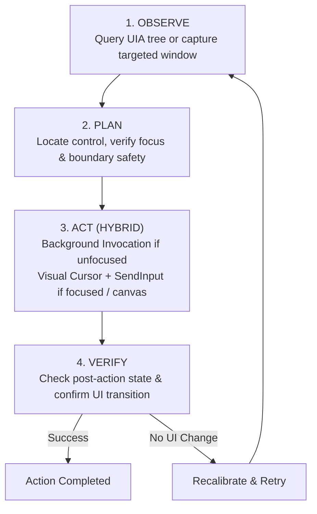

# Desktop Human Pilot Skill

This skill guides agents in operating native Windows desktop applications (Visual Studio, database clients, Figma, ERPs, settings consoles) with human-like precision, non-intrusive hybrid execution, and hard safety boundaries.

---

## 1. The Core Cognitive Loop: Observe → Plan → Act → Verify

Every interaction with native software must adhere to this 4-step loop. Never execute blind sequences without verification.

### Step 1: Observe (The Dual-Modal Hierarchy)
Always prefer semantic inspection over blind full-screen images:
1. **Semantic First**: Call `inspect_ui_tree(window_title="...")` or `find_element(query="Save")`.
   - Returns deterministic element coordinates `[x, y, width, height]` and `center`.
   - Consumes minimal tokens and is 100% immune to DPI scaling discrepancies.
2. **Visual Fallback**: If the app renders on a custom canvas (DirectX, Electron canvas, game engines) or controls lack UIA labels:
   - Call `capture_screen(window_title="...")`.
   - Prefer passing `window_title` to crop directly to the window, saving 80% of image tokens.

### Step 2: Plan
- Ensure the target window is authorized and belongs to the task.
- Activate boundary guard via `set_safety_boundary(enabled=True, window_title="...")` when working on an isolated application.
- Check if the action is destructive (e.g., "Delete", "Drop", "Format"). If destructive, pause and confirm with the user.

### Step 3: Act (Intelligent Hybrid Execution)
The server dynamically selects the optimal actuation mode:
1. **Background Invocation (Unfocused App)**:
   - When calling `click_element(query="Save", window_title="App")`, if the application is not the active foreground window, it invokes the button silently via UIA `InvokePattern` or Win32 messages.
   - **Benefit**: The user's mouse and keyboard are never seized; the user can continue typing in another window undisturbed.
2. **Foreground Visual Actuation (Focused App or Custom Canvas Fallback)**:
   - When the target application is already focused, or when a background control is on a custom canvas that does not support UIA patterns:
   - Automatically focuses the window, glides the Visual Pilot HUD cursor smoothly, displays a pointer hand on interactive elements, fires click ripple animations, and types with human cadence and an I-beam cursor.
3. **Boundary Protection**:
   - Every coordinate or window target is validated against `SafetyGuardian`. Any attempt to click outside the permitted boundary window is blocked.

### Step 4: Verify
- After acting, allow a brief UI settling pause (100–300ms).
- Check `get_active_window()` or `inspect_ui_tree()` to ensure the dialog closed, button state changed, or new view appeared.
- If no change occurred, retry once with an alternative selector or keyboard shortcut (e.g. `Enter` or `Tab`).

---

## 2. Window & Application Management Rules

1. **Launching Applications**: Use `launch_app(app_name="...")` to start software that is not yet running (e.g. `launch_app(app_name="notepad")`, `launch_app(app_name="chrome")`, `launch_app(app_name="code")`, or `launch_app(app_name="settings")`).
2. When calling `click_element(query="...", window_title="...")`, background invocation is attempted first if the window is in the background. If fallback to foreground is necessary, `focus_window` brings the application to the front.
3. Verify active application context with `get_active_window()` before typing passwords or queries.
4. If an application is minimized, `focus_window` will automatically restore it (`SW_RESTORE`).

---

## 3. Keyboard Shortcut Accelerators

Prefer native Windows keyboard shortcuts over slow mouse navigation whenever possible:
- Open Application / Command Palette: `Ctrl + Shift + P` or `Win + R`
- Close Window / Tab: `Ctrl + W` or `Alt + F4`
- Save State: `Ctrl + S`
- Switch Windows: `Alt + Tab`
- Full reference available in [windows_hotkeys.md](file:///f:/Personal/ComputerUse/nexus-pilot/skills/desktop-human-pilot/references/windows_hotkeys.md).

---

## 4. Emergency & Failsafe Handling

1. **Hardware Corner Failsafe**:
   - If the user moves the physical mouse to `(0, 0)` (top-left corner), the MCP server triggers an immediate emergency stop.
   - If an action returns `safety_abort: true`, do not attempt further actuation. Inform the user and wait for instructions.
2. **Boundary Violations**:
   - If `set_safety_boundary` is active and clicks fall outside the locked window, the server will block the click to protect personal apps and system trays.
